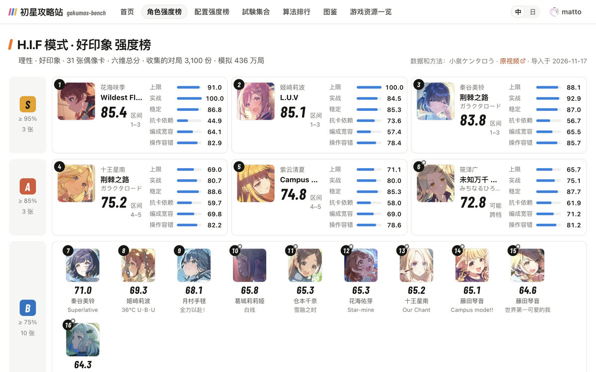
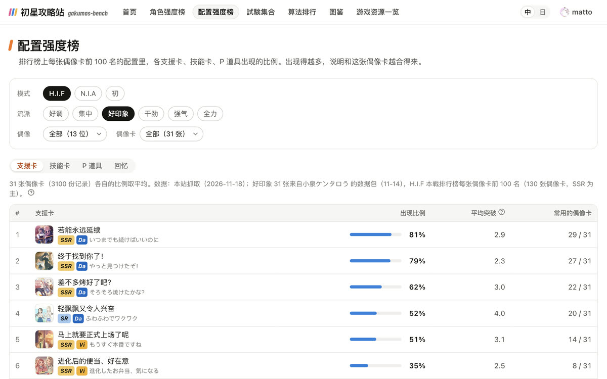
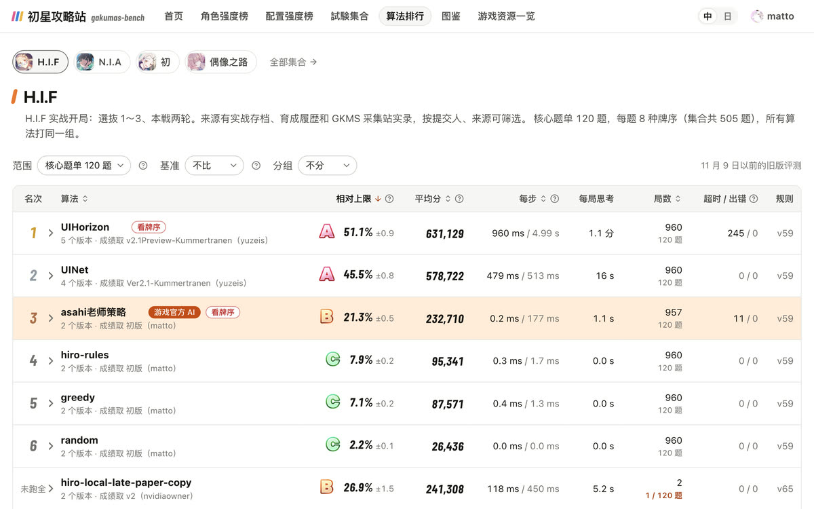

# 初星攻略站（gakumas-bench）

学园偶像大师（学マス）玩家做的中文攻略站：角色强度榜、配置统计、游戏资料图鉴，以及一套考试出牌算法的公开评测。

**网站：<https://gakumas.wiki/>**　·　介绍视频：[为了成为学马高手，我们制作了「初星攻略站」](https://www.bilibili.com/video/BV1qmst63EU6/)

## 网站上有什么

| 页面 | 内容 |
|---|---|
| **角色强度榜** | 偶像卡按上限、实战、稳定、抗卡依赖、编成宽容、操作容错六个维度打分，分 S 到 D 五档；点进一张卡能看推荐牌组和真实成绩。目前有 H.I.F 理性·好印象一张，数据来自小泉ケンタロう老师 |
| **配置强度榜** | H.I.F、N.I.A、初三个模式的排行榜上，每张偶像卡前 100 名的编成里，各支援卡、技能卡、P 道具和回忆带入的卡出现的比例；可以按流派、偶像、偶像卡筛 |
| **游戏资源一览** | 技能卡、饮料、P 道具、偶像卡、支援卡、回忆能力，数据直接取自游戏；支援卡能看每个突破档的数值和事件；卡名和效果可以在日文、中文之间切换 |
| **图鉴** | 立绘、偶像卡卡面、支援卡卡面、衣装、发型 |
| **出牌助手** | 配好 H.I.F 编成（可从题库、本机保存或编成码带入，兼容 GKMS「导出 GKMSUINet」的对局码），一边在游戏里打一边看 AI 建议：每回合把抽到的牌点进来，给出每个出法的概率和预计最终得分；也能让引擎自己抽牌练一场。建议来自 GKMS rev383 引擎 + UINet Ver2.1，不看种子 |
| **試験集合 / 算法排行** | 收集来的实战考试开局，让各种出牌算法用同样的牌序打，比分数和每步耗时（见下） |

<table><tr>
<td></td>
<td></td>
</tr><tr>
<td></td>
<td></td>
</tr></table>

## 出牌算法评测

考试里每一步出哪张牌，可选的打法多到数不过来：以 H.I.F 本战第二轮为例，牌堆光排列顺序就有 10²⁰ 到 10²³ 种。这部分就是为了比较「哪个算法打得更好」。

- **题**：实战考试的开局（偶像、牌组、P 道具、饮料），分成 H.I.F、N.I.A、初、偶像之路几个集合。H.I.F 另有一份核心题单：120 题，每题 8 种牌序。
- **公平**：所有算法打同一组牌序；牌序只在服务器上，算法看不到。裁判用 [GKMS](https://github.com/yuzeis) 的原生引擎推进对局、核对分数，**算法和玩家一样，只能看到画面上的信息**。
- **排名看「相对上限」**：每一局用提前知道牌序的搜索（GNRPA，多起点）找到的最高分当分母。它是目前找到的最好打法，不是证明过的最优解，以后找到更好的路线会更新。

规则、种子怎么生成、为什么用核心题单，见 [docs/evaluation.md](docs/evaluation.md)；题和答的数据格式见 [docs/format.md](docs/format.md)。

### 接自己的算法

不需要改本仓库，也不需要装游戏引擎：

1. 装包（Python 3.10+）：

       pip install "gkbench @ git+https://github.com/matto49/gakumas-bench"

2. 在网站「我的」页生成令牌，存到 `~/.config/gkbench/token`（或设 `GKBENCH_TOKEN`）。
3. 写算法：继承 `gkbench.algos.base.Algorithm`，实现 `decide(ctx) -> Decision(action, meta)`。`ctx.obs` 是画面上能看到的信息，返回的动作要在 `ctx.obs["legal"]` 里。最小例子：[examples/first_playable.py](examples/first_playable.py)。
4. 评测：

       python -m gkbench eval --set hif --algo my_algo.py:MyAlgo --parallel 3

   缺省按核心题单跑，成绩会出现在网站的算法排行上；中断了用 `--resume <评测编号>` 接着跑。

这样跑每一步都要和服务器来回，**耗时不能和别人比**。想让耗时也可比，把算法提交到 [submissions/](submissions/README.md)（开 PR），合并后由固定的一台评测机在断网沙盒里跑完上传，排行上标「固定机器」。

用别的语言写、要「可能的世界」（PIMC 这类）、给算法写说明，见 [docs/evaluation.md](docs/evaluation.md#接自己的算法完整说明)。

## 自己出题

试験集合可以自己建，题目自己传。按 [docs/format.md](docs/format.md) 的「写一道题」写一份开局配置（字段表、完整例子都在那一章，可以直接交给 AI 照着写），然后用命令行工具上传：

    curl -fsSL https://gakumas.wiki/install.sh | sh
    gkbench login
    gkbench upload exam.json --set <集合>

服务器会交给引擎核对能不能开局，入库后自动配好保密牌序。

## 数据来源与致谢

| 内容 | 来源 |
|---|---|
| 角色强度榜 | 小泉ケンタロう老师的「H.I.F 好印象强度榜」数据包（[原视频](https://www.bilibili.com/video/BV1mGsJ6AEJ1/)），站上只放汇总 |
| 技能卡、P 道具、饮料、偶像卡、回忆能力，考试引擎 | [GKMS](https://github.com/yuzeis)（yuzeis/GKMSProject）读出的游戏主数据和原生引擎 |
| 出牌神经网络 UINet | [yuzeis/GKMSUINet](https://github.com/yuzeis/GKMSUINet) |
| 支援卡、生日、新卡 | [vertesan/gakumasu-diff](https://github.com/vertesan/gakumasu-diff) |
| 中文卡名和效果 | [学マス汉化插件的翻译数据](https://github.com/imas-tools/gakumas-master-translation) |
| 配置强度榜 | 本站从游戏排行榜抓取，存的时候不留其他玩家的名字和 ID |
| 卡池、活动 | 手动整理 |

## 仓库结构

| 目录 | 内容 |
|---|---|
| `web/` | 网页（Vite + React + TypeScript + Tailwind + TanStack Query） |
| `server/` | 服务器（Go + Gin）：接口、账号和令牌、托管对局、评测、排行榜；`cmd/gkbench` 是命令行工具 |
| `gkbench/` | Python：审查存档、题库、裁判、内置算法、本地跑分、客户端，以及和 GKMS 引擎打交道的部分 |
| `submissions/` | 提交给固定评测机的算法 |
| `docs/` | [评测规则](docs/evaluation.md)、[数据格式](docs/format.md)、[运维手册](docs/operations.md) |

题库、种子、运行结果、令牌都在仓库外的 `$GKBENCH_DATA`，不进仓库。

## 本地开发

    cd server && go run .                 # 127.0.0.1:19150
    cd web && pnpm install && pnpm dev    # http://127.0.0.1:5180/gkbench/，接口转给本地的 Go 服务器

跑本地裁判和内置算法（贪心、PIMC、UINet、理论上限）还要 GKMS 引擎；依赖、命令、接口、数据生成和线上部署都在 [docs/operations.md](docs/operations.md)。

## 规矩

- 实战和开源版本不用种子；种子只在这里做离线评测、算理论上限。
- 测试集的固定种子题不导出，对局的逐步记录不公开（会暴露抽牌顺序）。
- 上传的成绩一律记为 `self`：服务器核对过分数，但证明不了算法没偷看种子；可信度最高的是 `hosted`。
- 仓库里不放读存档、解密、还原种子的代码；题目从存档转出来的那一步在仓库外做。
- GKMS 代码不进本仓库，按路径引用（和作者共建）。

## 许可

本仓库的代码（`gkbench/`、`server/`、`web/`、`tools/` 等）以 [GNU AGPL-3.0-or-later](LICENSE) 发布（2026-11-20 起；之前的版本是 MIT）。可以引用、改写、接进别的项目；改过的版本分发出去，或者放到网上给别人用，要同样以 AGPL 公开源码。

不在本许可内的东西：
- GKMS（yuzeis/GKMSProject，仓库不公开）：rev383（Ver3.17.9）及以前是 AGPL-3.0-only，rev384 起保留所有权利。本仓库只按路径引用它的引擎、不包含它的代码，线上服务器用的是 AGPL 版本、没有修改；
  `gkbench/algos/native/official_ai_ext.cpp` 编译时要 `#include` GKMS 的核心，所以只能在装了 GKMS 的机器上编。
- UINet 的模型和代码在 [yuzeis/GKMSUINet](https://github.com/yuzeis/GKMSUINet)（MIT），按它自己的许可。
- `submissions/` 下别人提交的算法按各自作者的许可。
- `gkbench/algos/hiro.py` 运行时引用 [hiro-gakumas-hero](https://github.com/matto49/hiro-gakumas-hero)（GPL-3.0-or-later），不包含它的代码。
- 卡面、图标等游戏素材和主数据的权利属于游戏的权利人，这里只作研究用途。本站由玩家个人制作，和游戏开发商、运营方没有关系。
